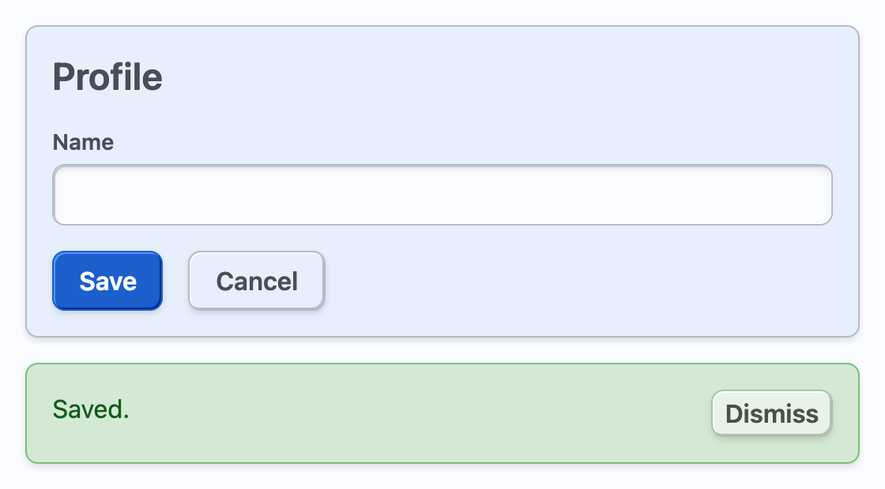

# answerui


<!-- WARNING: THIS FILE WAS AUTOGENERATED! DO NOT EDIT! -->

answerui styles semantic HTML for [FastHTML](https://fastht.ml) apps. Page markup stays small and readable because each component is an HTML tag, each variant or state is an attribute, and classes are used only for utilities. One registry holds every component’s CSS and behavior. Each page includes the whole registry as one stylesheet and one script. An app changes the look by registering ordinary CSS in the same registry, scoped to a token, a component, or a region.
answerui is built for a human working with an LLM in a persistent Python kernel. Its pyskill, `answerui.skill`, teaches the model how to build a page, read and change what is registered, and check the result.

## Install

``` sh
pip install -e .
```

## Use

`reg.hdrs()` gives the stylesheet and the behavior script, and `reg.ftrs()` gives the sprite sheet for icons. A rule registered after the app is created still appears on the next page, because both are rendered again for each response:

``` python
from fasthtml.common import *
from answerui.all import *
```

``` python
app = FastHTML(hdrs=reg.hdrs(), ftrs=reg.ftrs())
rt = app.route
```

`reg.serve(app)` serves the same assets at URLs named by a hash of their content. The browser fetches each URL once and caches it. When a rule changes, the assets are rebuilt and the next page links to them at new URLs.

A page is native HTML inside layout containers, with a component wherever HTML has no element for the job. Variants and severities are attributes:

``` python
page = Card(H2('Profile'), Field('Name', Input(name='name')), Cluster(Button('Save'), Button('Cancel', secondary=True)))
print(to_xml(page, Alert('Saved.', success=True, dismissible=True)))
```

    <div stack card>
      <h2>Profile</h2>
      <div field>
    <label>Name      <input name="name">
    </label>  </div>
      <div cluster>
    <button>Save</button><button secondary>Cancel</button>  </div>
    </div>

    <div card alert success>
      <div stack style="--gap: var(--space-2);">Saved.</div>
    <button type="button" secondary dismiss>Dismiss</button></div>

The image below is that markup rendered with the registry’s stylesheet. In a notebook, `demo(page)` shows the same thing live:



## Customise

Register ordinary CSS at the smallest scope that covers the change: a token on the root for the whole app, a rule on a component, or a selector for a region. Because the `app` cascade layer comes after every framework layer except `utilities`, app rules override the framework’s styles with no edit to the framework:

``` python
reg.rule('theme', ':root { --hue: 150; --radius: 0; }')
Button.rule('caps', 'text-transform: uppercase;')
```

    Button.caps [app] button, a[button]

A variant is a new style declared on a component. The component’s constructor accepts it as an attribute, and the component’s documentation lists it:

``` python
Button.variant('cta', '--pad-block: var(--space); --pad-inline: var(--space2); font-size: var(--text1);', doc='The landing page call to action.')
```

    Button.cta [app] :is(button, a[button])[cta]: The landing page call to action.


``` python
Button
```

### `Button(*children, **attrs)`

Raised at rest, down while active, busy, or expanded, latched by `aria-pressed`; `secondary` for the lesser action; a link carrying `button` is styled the same way.

Root selector: `button, a[button]`.

Declared variants:
- `secondary`: The lesser action: the neutral surface with a hairline border, and the accent wash when latched.
- `quiet`: No face, border, or shadow at rest, for an action that should not compete: dismiss, close, and toolbar buttons.
- `editable`: A value drawn as the dashed ghost of the well it becomes; click to edit, and the app swaps the form in.
- `cta`: The landing page call to action.

Rules:
- `base` (components)
- `icon-only` (components): A button whose only child is an svg is square; give it an aria-label.
- `caps` (app)

## Previews in notebooks

`demo(page)` renders markup in an iframe with the current stylesheet and behaviors. It returns a preview with two representations: the frame as HTML, and the markup as Markdown. The frame holds the whole stylesheet. Storing frames would make a notebook with many previews large, and each style change would alter every stored preview. The preview therefore marks its HTML with nbdev’s `strip` flag. `nbdev-clean` drops the frame and keeps the Markdown, so the committed notebook records what each preview showed. In a fresh clone, run the cells to show the frames again.

For the docs, set `exec_all` in `pyproject.toml`:

``` toml
[tool.nbdev]
exec_all = true
```

`nbdev-docs` then runs every notebook and renders each preview from the current code.

## With an LLM

`answerui.skill` is a [pyskill](https://github.com/AnswerDotAI/pyskills): a module whose docstring teaches a model the library. `list_pyskills()` finds it, `doc(answerui.skill)` is the guide, and `doc(Button)` describes a component, its variants, and its rules.
